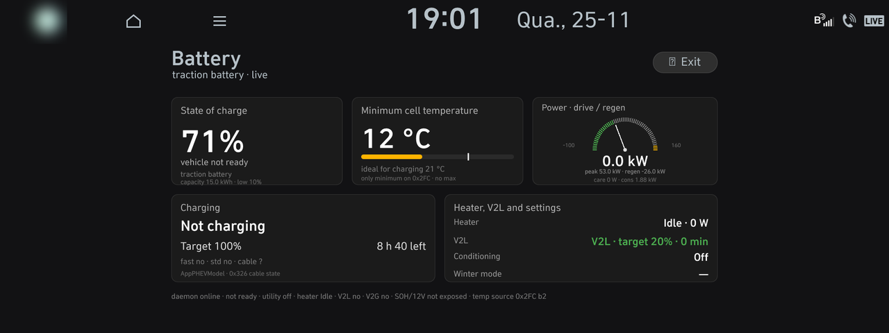

# Battery page, I-CAN signals, gauge and the limits of what the car exposes

Status: **car-validated** page and daemon on the owner's IONIQ 5 Gen5W.
Some signal decodes are derived from the firmware and are not all
car-validated; see the notes.

## Bus split

One of the head unit's CAN interfaces is **I-CAN**, not M-CAN: `can0` on
some units, `can1` on this car. The battery daemon runs against the I-CAN
interface (check your unit with `--sniff` and the service unit). Useful data
is split:

| Data | Bus / source | Notes |
|---|---|---|
| State of charge | I-CAN `0x2FC` | display SoC |
| Minimum cell temperature | I-CAN `0x2FC` byte 2 | only the **minimum**; no max |
| Charge cable / charging | I-CAN `0x326` | also standard/fast charge states |
| Preheat / utility | `0x2AD` / `0x2AE` | may be M-CAN on some builds |
| Charge door | `0x3AA` | may be unavailable on the I-CAN interface |
| Heater instant power | `AppPHEVModel.pwrInstantHeat` | factory model, not CAN in the page |
| Battery instant power | `AppPHEVModel.pwrInstantBattery` | factory model |
| Drive/regen power | `AppPHEVModel.pwrInstantDrivingKw` | factory model, signed |
| Consumption | `AppPHEVModel.consumptionPower` | factory model |
| Charge target/time | `AppPHEVModel.batChgLvlFast/Normal`, `fastChgRemTime`, `portChgRemTime` | minutes; `0xFFFF` invalid |
| V2L | `dischargingLevel`, `V2LDischargeTime` | percent/minutes |
| Conditioning/winter | `batteryConditionMode`, `winterMode` | **settings**, not measurements |

M-CAN data (gear, READY, utility, BMS detail) is not visible on the I-CAN
interface (`can0`/`can1`).
The factory QML models (`AppPHEVModel`, `appClimateModel`, `AppNModeModel`)
are the safest source for values the vendor already decodes.

*Battery page on the car: SoC, minimum cell temperature, signed drive/regen
gauge, charging, heater/V2L and the status footer.*

## What the page shows

`reference/qml/BatteryPage.qml` (Tweaks → Battery):

- **State of charge** (factory `batLevel`, daemon fallback), READY/utility,
  battery capacity and low-SOC threshold when available.
- **Minimum cell temperature**, a 0–30 °C bar with the 21 °C charging mark,
  and an explicit note that only the minimum exists.
- **Power** card with a semicircular drive/regen manometer:
  - range **-100 to 160 kW** (headroom for regen; the car's peak is 160);
  - signed value, green for regen; peak and regen lines;
  - battery-care power (`pwrInstantHeat + pwrInstantBattery`) and
    consumption in small text.
- **Charging**: fast/normal/not charging, target SOC, remaining time,
  cable state, fast/std flags.
- **Heater, V2L and settings**: heater state + instant power, V2L target and
  remaining time, battery conditioning and winter mode.
- Footer: V2L/V2G support, "SOH/12V not exposed", temperature source.

## Important discoveries

- **`heatBatteryPercent` is not heater strength.** It is a rounded share of
  total electricity use; 0% does not mean the heater is off. The useful
  number is `pwrInstantHeat + pwrInstantBattery` in W (kW after /1000).
- **`pwrInstantDrivingKw` is signed.** Negative values are regenerative
  braking and must be displayed as such. An early version of the page hid
  every negative value; the final page shows `-12.3 kW` in green and keeps
  a peak/regen record until the page/app restarts.
- **The 150/160 kW question is not a UI clamp.** The page displays the
  factory value raw. At 40% SoC and 16 °C the BMS can derate; 160 kW is a
  peak figure under favourable conditions. If the peak line never exceeds
  150.0 even with a warm battery and high SoC, the model/signal is capped;
  that would need the raw CAN signal or a model change.
- **Conditioning and winter are settings**, not live states:
  `batteryConditionMode` is the factory "Battery Conditioning Mode" toggle
  (saved through the micom), and `winterMode`/`winterModeAvailable` is the
  winter-mode setting. The manual preheat is a different thing (`0x2AD` +
  instant power).
- **Only the minimum cell temperature is available.** There is no maximum,
  no per-cell voltage and no pack voltage in the exposed data.
- **12 V:** SoC/state/thresholds exist in the signal map (ICU/BAT frames),
  but the battery page does not expose a 12 V **voltage**; the models used
  by the page do not provide it.
- **SOH:** `xEV_Bms_GDS_SOH` appears in the signal map on an extended GDS
  frame (`0x1405502`), but it was not validated on this car and is not
  exposed by the QML models. Treat SOH as unavailable until proven
  otherwise.

## Daemon

`reference/daemon/battery_daemon.c`:

- reads the I-CAN, decodes SoC/temperature/cable/charging/door when present;
- sends the preheat and charge-door commands through the micom D-Bus;
- exposes HTTP/JSON on `127.0.0.1:8088` (`/status`, `/logs`, commands);
- stores logs/status in `/rw_data/battery/`;
- caps `daemon.log` at **1 MiB**, truncating in place once per second (the
  systemd unit holds an `O_APPEND` descriptor; a rename would leave it
  writing to the unlinked inode and the 1.2 GB `/rw_data` would still fill);
- runs on the I-CAN interface: this car used `can1`; the reference unit
  shows the argument layout with `can0`, so set `--iface` to your own
  interface name;
- includes the optional Home Assistant door hook (see
  `docs/03-home-assistant.md`).

The daemon restarts independently of the WiFi daemon; replacing it does not
drop SSH. Keep a backup (`battery_daemon.before-*`) and the service unit.

## Installing the page

- Build/copy the daemon to `/rw_data/battery/battery_daemon`.
- Install `BatteryPage.qml` under
  `/app/share/AppHomeScreen/qml_eco3.0/HomeScreen/`; the OEM `Advanced.qml`
  needs the `BatteryPage { id: batteryPage }` instance (the upstream Tweaks
  wiring). **Do not** set `visible: false` on that instance: it overrides
  the page's internal `visible: requested && ...` binding and the page
  never opens. Set `y: ConstantModel.MENU_BAR_Y` and `z: 2000` instead.
- Restart AppHomeScreen; no WiFi drop.
- Keep the previous page as `/rw_data/tweaks/BatteryPage.before-*.qml`.

Status: page/gauge and the door hook are car-validated. SOH/12 V voltage and
per-cell data remain out of reach on this firmware.
