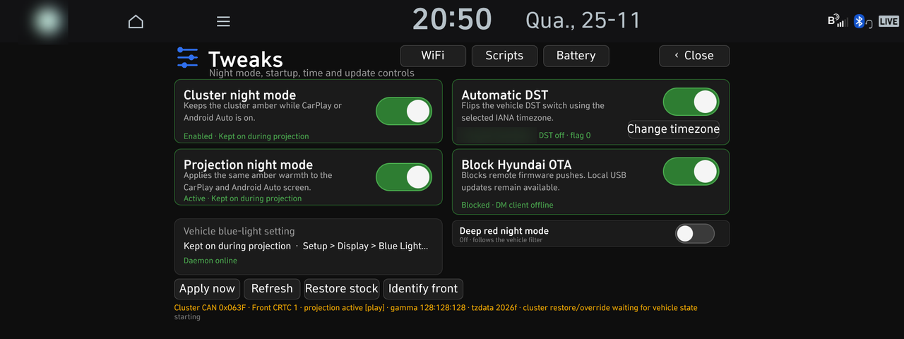

# Install, backup and rollback

This repository is a **reference and a runbook**, not a standalone package.
The reference files are meant to be dropped into the upstream SCOURGE
package layout and built with the upstream tooling. The upstream project is
[nickles-lee/hkg_SCOURGE](https://github.com/nickles-lee/hkg_SCOURGE); read
its `docs/06-run-stuff.md`, `docs/07-packages.md` and `AGENTS.md` first.

## Prerequisites

- Your own rooted Gen5W head unit, parked and off-road; a USB pen with the
  upstream failsafe payload; backups.
- Upstream SCOURGE source and packages; a way to cross-build static x86-64
  binaries (the upstream build scripts/Makefiles).
- The placeholders in this repository replaced with your values:
  - `<YOUR_SSID>` / `<YOUR_PSK>` / `<CAR_IP>` / `<HA_IP>`
  - `192.168.1.x` LAN example, `192.168.2.x` IOT example
  - `AA:BB:CC:DD:EE:01/02` BSSID placeholders
  - `switch.your_plug`, webhook IDs
- A rollback plan for the UI (a bad Advanced/QML edit can blank the home
  screen) and for the WiFi daemon (a restart drops SSH).
- Change the upstream product default SSH account (`car`/`electric`) and
  password on your unit before enabling SSH on any network. The default is
  a documented factory default, not a secret, but it is not safe to keep.

## 1. WiFi

### Build

The daemon source is `reference/daemon/wifi_daemon.c`. Copy it over the
upstream package's `packages/wifi/src/wifi_daemon.c`, then build with the
upstream build script (`packages/wifi/scripts/build_payload.sh`) or a static
`gcc` command. The binary is installed as:

```
/rw_data/wifi/wifi_daemon
```

The service unit is `reference/systemd/wifi-daemon.service`; it runs
`/rw_data/wifi/wifi_daemon --port 8090 --status-file /rw_data/wifi/status.json`
and restarts on failure.

### Page

Copy `reference/qml/WifiPage.qml` to:

```
/app/share/AppHomeScreen/qml_eco3.0/HomeScreen/WifiPage.qml
```

It needs the upstream `WifiButton`, `WifiSwitch` and stock `QText`/theme
components. The OEM `Advanced.qml` only needs the page instance; do not
redistribute the OEM file. Back up the previous page and clear the QML
caches before restarting AppHomeScreen.

### Config

`/rw_data/wifi/config.conf` (root-only) needs at least:

```ini
mode=client
wlan_on=1
boot_off=0
ssid=<YOUR_SSID>
psk=<YOUR_PSK>
static_ip=192.168.1.228
static_mask=255.255.255.0
static_gw=192.168.1.1
ssh=1
ssh_port=2222
client_bssid=
```

- `boot_off=0` keeps WiFi on across boots.
- `client_bssid` is optional; set your nearest AP BSSID to pin, or leave
  empty for automatic selection.
- There is no DHCP: choose a free static address on the target subnet.
- The import format is `scripts/config/wifi.txt.sample`.

### Install and test

Use `scripts/install-wifi-ui.sh` (pen) or copy the daemon/page manually.
Back up the daemon, page and config first. A daemon restart drops WiFi/SSH;
use a local watchdog that restores the previous daemon if there is no
`COMPLETED` + IP after ~50 s. The page restart only restarts AppHomeScreen.

Test:

```sh
wpa_cli -p /var/run/wpa_supplicant -i wlan0 status
ip -4 addr show wlan0
ip route
ping -c2 <gateway>
ping -c2 1.1.1.1
```

## 2. Battery page and daemon

### Build

Copy `reference/daemon/battery_daemon.c` over the upstream battery package
source, build it static, install as:

```
/rw_data/battery/battery_daemon
```

The upstream service unit is `reference/systemd/battery-daemon.service`
(check the `--iface` value; this car used `can1`). The daemon restart does
not drop WiFi/SSH.

### Page

Copy `reference/qml/BatteryPage.qml` to the Tweaks package's
`HomeScreen/BatteryPage.qml`. In the installed `Advanced.qml`, ensure the
instance is:

```qml
BatteryPage {
    id: batteryPage
    y: ConstantModel.MENU_BAR_Y
    z: 2000
}
```

**Do not set `visible: false` on the instance.** It overrides the page's
internal `visible: requested && ...` binding and the page never opens. Back
up the previous page and restart AppHomeScreen.

The daemon HTTP API is `127.0.0.1:8088` (`/status`, `/logs`, commands). Do
not expose it to the LAN.

### Door hook (optional)

Build the daemon with the door hook (the reference `battery_daemon.c`
already includes it) and keep the binary, e.g. as
`scripts/battery_daemon_hook` (ignored by git). Then run
`scripts/install-door-hook.sh`; it installs that binary and writes
`/rw_data/battery/door_hook.conf`:

```ini
open_url=http://<HA_IP>:8123/api/webhook/<OPEN_WEBHOOK_ID>
close_url=http://<HA_IP>:8123/api/webhook/<CLOSE_WEBHOOK_ID>
```

```sh
HOOK_BIN=/path/to/battery_daemon_hook \
  ./scripts/install-door-hook.sh 'http://<HA_IP>:8123/api/webhook/<OPEN_WEBHOOK_ID>'
```

Mode 600. The script refuses to run if `HOOK_BIN` is missing. See
`docs/03-home-assistant.md`.

## 3. Climate tile

Copy `reference/qml/ClimateTile.qml` to:

```
/app/share/AppHomeScreen/qml_eco3.0/component/ClimateTile.qml
```

Patch your own Advanced file with:

```sh
python3 scripts/add-climate-tile.py /path/to/QHMI_HomeScreenMain_Advanced.qml
```

It inserts the tile in the next free slot on pages 0-2 (the script anchors
after the pre-heat tile) and writes a `.before-climate-tile` backup.
Restart AppHomeScreen.

## 4. Home Assistant

Import `scripts/home-assistant/charge-door.yaml` as automations (or split
it), replace `switch.your_plug`, enable them, and set the webhook URLs in
`door_hook.conf`. The hook supports `http://` + IPv4 only. Test the webhook
from a host first, then press the Charge Port tile.

## Backups and rollback

Keep at least:

| File | Backup |
|---|---|
| `/rw_data/wifi/wifi_daemon` | `wifi_daemon.before-*` |
| `/rw_data/wifi/config.conf` | `config.conf.before-*` |
| `/app/.../WifiPage.qml` | `/rw_data/wifi/WifiPage.before-*` |
| `/rw_data/battery/battery_daemon` | `battery_daemon.before-*` |
| `/app/.../BatteryPage.qml` | `/rw_data/tweaks/BatteryPage.before-*` |
| `/app/.../Advanced.qml` | `.before-*` |

UI restarts do not drop WiFi; daemon restarts do. Always keep an SSH/pen
path back in, and never test while driving.

## Layout fixes (Climate tile and Tweaks page)

`scripts/install-ui-fixes.sh` installs two layout fixes, validated on the car
on 2026-11-25:

- `ClimateTile.qml`: INT and EXT now sit in two compact rows inside the
  standard icon square, with the Clima label below; the tile no longer
  draws a small background with the values outside it.
- `TweaksPage.qml`: the Cluster card has room for its wrapped body, the
  Deep red card moved to the right column and its overlapping subtitle
  became a compact dynamic status line, and the action/diagnostic rows
  moved up to fit the viewport.

The page budget is about 600 logical pixels: the content box is 1180x630,
the lowest text now ends at ~587, and the previous layout clipped the
message row. Confirm the real usable height on your firmware.

The script backs up both files to `/rw_data/tweaks/*.before-layoutfix.qml`, clears the
QML cache, restarts AppHomeScreen through AppLauncher, and rolls back if the
process does not come back:

```sh
./scripts/install-ui-fixes.sh car@<CAR_IP> 2222
```



*Tweaks page after the layout fixes; the timezone is blurred.*

After any reinstall, open the home screen and the Tweaks page and check the
Clima tile, the Cluster card and the bottom action row. To roll back
explicitly:

```sh
./scripts/install-ui-fixes.sh --rollback car@<CAR_IP> 2222
```

The script keeps the first copies as stock (`*.before-layoutfix.qml`), so
re-running it does not overwrite the rollback source. Rollback restores the
files even when AppHomeScreen is down; it restarts the UI only if
AppLauncher and the session bus are available, otherwise it prints
`ROLLBACK_FILES_RESTORED_NO_RESTART` and you can restart/reboot manually.

## Disk inventory and log hygiene

`/rw_data` is a 1.2 GB partition shared with navigation data. Old rollback
copies, archives copied back to it, core files and uncapped logs can fill
it. (The daemons write USB dumps to the stick under `/media` or `/run/media`,
not to `/rw_data`.) A full partition breaks status writes, dumps and
updates.

The logs of the reference daemons are capped at 1 MiB (truncated in place).
To see what is actually using the space, run the **read-only** inventory on
the car, as root (`car` is uid 0 on this firmware; permission errors are
suppressed, so another user would under-report):

```sh
ssh -p 2222 car@<CAR_IP> 'sh -s' < scripts/rw-data-inventory.sh \
    > /tmp/rw-data-report.txt
```

It never deletes or modifies anything on the car (`--out` only truncates
the local report). It prints filesystem/inode usage,
the largest entries and files, and groups logs, rollback copies
(`*.before-*`), other leftovers, archives, firmware payloads, cores, QML
caches, navigation data and protected runtime files, with a
review/keep/do-not-delete summary. Keep the report local: it can contain
private filenames and SSIDs.

Delete only explicit paths, one at a time, with the car parked and a copy on
a pen of anything you still need. Safe candidates are **older duplicates**
of `*.before-*`, plus other leftovers, cores, QML caches, completed archives and
oversized logs. Keep the newest rollback copy of each daemon, page and
config; keep `/rw_data/app_data`, daemons, `bin/` helpers and SSH keys. A
running writer keeps its log descriptor open, so `rm` does not free a log
until restart — use `: > file` to truncate it in place instead.

## Safety and scope

- Own hardware only, parked, off-road.
- Do not flash firmware or touch the updater/bootloader for these tweaks.
- Do not write `/sys/module/micom/parameters/secure_console`; on this
  platform that can trigger a watchdog reset.
- Do not expose the car's daemon HTTP APIs to the LAN.
- Keep the upstream licence and attribution; this is AGPL-3.0-only.
